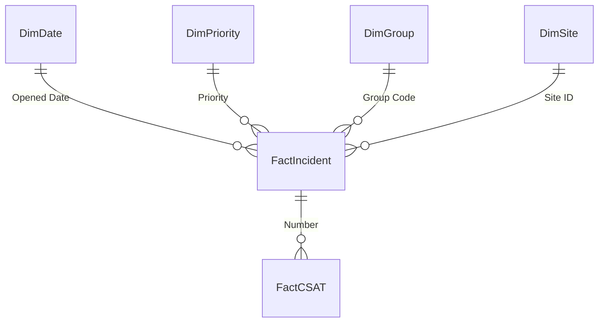

# Data model

| Table | Grain / role | Source |
|---|---|---|
| FactIncident | One row per incident (after de-duplication), with durations, SLA flags, age and shift calculated in Power Query | ITSM export (CSV) |
| FactCSAT | One survey response | Survey export (CSV) |
| DimDate | Day, generated in Power Query | – |
| DimPriority | P1–P4 with response and resolution targets | SLA policy (Excel) |
| DimGroup | Resolver group, type and vendor, plus an "Unassigned" row | Workforce API (JSON) |
| DimSite | Customer site with municipality, segment and devices | Site master (Excel) |
| DimRelease | Platform release calendar (reference table, not related) | CSV |
| KPI Targets | Targets, direction and weights for the scorecard | Excel |
| Data Quality Log | Counts of every data issue found, built in Power Query | – |

## Design choices
- **SLA logic lives in Power Query.** Each incident carries its own Response Met / Resolution Met flags, so measures are simple counts and the logic is visible in one place.
- **Municipality comes from the site master**, not the free-text field in the export, which is inconsistent.
- **FactCSAT relates to FactIncident**, so every incident filter (resolver, priority, date) also filters satisfaction scores.
- **Median and P90 instead of averages** for durations, because resolution times are heavily skewed.
