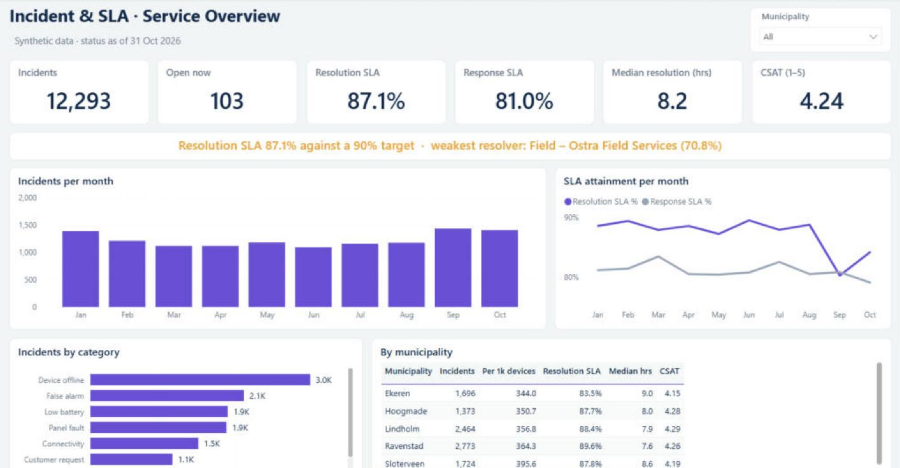
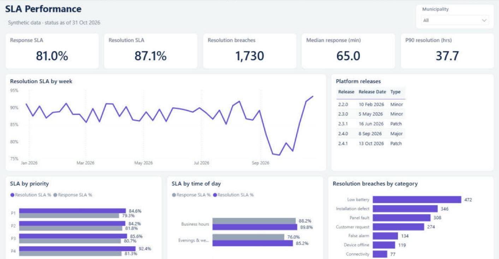
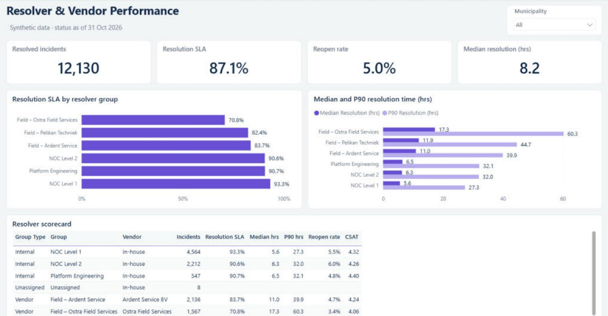
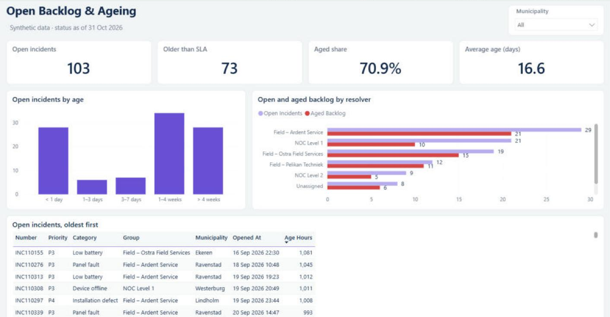
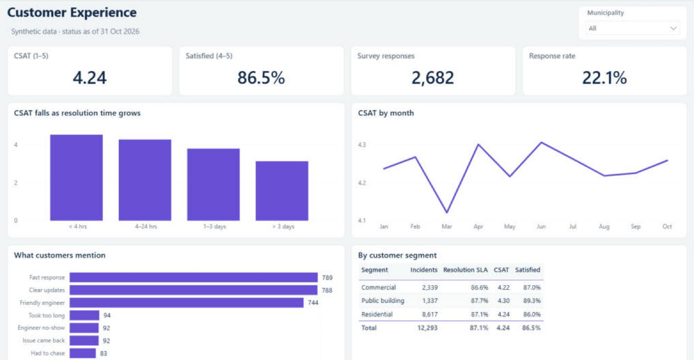

# Incident & SLA Analytics · Power BI

A Power BI project for **Veyra Safety Services**, a fictional company that monitors connected fire and smoke alarms for 2,400 customer sites. It turns a messy ITSM export and five supporting sources into one model showing whether incidents are fixed within SLA, which resolvers and shifts miss it, how the open backlog is ageing, and what that does to customer satisfaction.

> **All data is synthetic.** Veyra, its municipalities, vendors, sites and incident numbers are invented. The data is produced by [`scripts/generate_data.py`](scripts/generate_data.py) with a fixed seed, so every number here can be reproduced.

## The business problem

The service desk reported incident counts every month, but the operations manager couldn't answer the questions that matter for a service contract:

- Are we meeting the response and resolution SLA, and where do we miss it?
- Is the problem internal teams, field vendors, or the time of day an incident comes in?
- How much of the open backlog is already past its SLA?
- Does slow resolution actually hurt customer satisfaction?

Full requirements: [Documentation/business_requirements.md](Documentation/business_requirements.md)

## What the report shows (Jan – Oct 2026)

| | |
|---|---|
| **12,293** incidents | **68%** detected automatically by monitoring |
| **87.1%** resolution SLA | target 90% |
| **81.0%** response SLA | target 95% |
| **103** open incidents | **71%** already older than their SLA |

Key findings:

1. **One field vendor is the biggest SLA risk.** Ostra Field Services resolves 70.8% within SLA, against 90%+ for the internal NOC teams. Its median fix takes 17 hours, and its slowest 10% take more than 60.
2. **Response SLA is an out-of-hours problem.** 88% of incidents raised in business hours are picked up on time, compared with 76% in evenings and at weekends. Staffing, not process, is the lever.
3. **A platform release caused a month-long dip.** After release 2.4.0 on 8 September, panel faults tripled and weekly resolution SLA fell to about 76% until the 2.4.1 patch. 337 incidents are linked to that release.
4. **Speed drives satisfaction.** CSAT is about 4.5 when an incident is fixed within 4 hours and falls to about 3.1 when it takes longer than 3 days.

## Report pages

| Page | Purpose |
|---|---|
| Service Overview | Headline KPIs, dynamic SLA headline, monthly volume and SLA trend, category and municipality view |
| SLA Performance | Weekly resolution SLA with the release calendar, SLA by priority and by shift, breaches by category |
| Backlog & Ageing | Open incidents by age bucket and resolver, list of the oldest open incidents |
| Resolvers & Vendors | SLA, median and P90 resolution time, reopen rate and CSAT per resolver group |
| Customer Experience | CSAT by resolution time, trend, survey themes, segment comparison |
| Scorecard & Data Quality | Weighted KPI scorecard against targets, data-quality checks applied |

## Data sources

| File | Format | Mimics |
|---|---|---|
| `itsm_incident_export.csv` | CSV | ITSM tool export, one row per incident, `dd/MM/yyyy HH:mm` timestamps |
| `sla_policy_and_targets.xlsx` | Excel | SLA targets by priority and KPI targets |
| `resolver_groups_api.json` | JSON | Workforce API listing internal teams and field vendors |
| `customer_sites.xlsx` | Excel | Customer site master with municipality, segment and device count |
| `csat_survey_responses.csv` | CSV | Post-resolution survey tool export |
| `release_calendar.csv` | CSV | Platform release dates |

The raw export contains deliberate problems: duplicate rows, priority written five different ways (`P1`, `High`, `2 - High`, `low`…), resolved timestamps earlier than opened timestamps, open incidents with no resolver group, municipality names in capitals, and survey responses for incidents that don't exist. Power Query fixes or flags each one, and the **Data Quality Log** table reports how many records each check affected.

## Data model and DAX

Star schema: `FactIncident` (one row per incident) with date, priority, resolver group and site dimensions, plus `FactCSAT` related through the incident number. SLA flags, durations, age buckets and the shift are calculated in Power Query, so the 32 measures stay simple and fast.

Highlights:
- **Response / Resolution SLA %**: share of incidents within the target for their priority
- **Median and P90 resolution time**: P90 shows the long tail that averages hide
- **Aged Backlog %**: open incidents already older than their SLA
- **SLA Headline**: a sentence naming the weakest resolver, which updates with every filter
- **KPI scorecard**: targets, direction and weights stored in Excel, with mixed formats (% and a 1–5 score)

Details: [data model](Documentation/data_model.md) · [DAX catalogue](Documentation/dax_measures.md) · [Power Query steps](Documentation/power_query.md) · [data dictionary](Documentation/data_dictionary.md)

## How to open it

1. Install [Power BI Desktop](https://www.microsoft.com/power-platform/products/power-bi/desktop) (Windows).
2. Clone the repo to `C:\BI-Portfolio\veyra-incident-sla`, or change the `DataFolder` parameter in **Transform data → Edit parameters** (keep the trailing `\`).
3. Open `PowerBI/Veyra SLA.pbip` and click **Refresh**.

To regenerate the data: `pip install pandas numpy openpyxl` then `python scripts/generate_data.py`.

## Tools

Power BI Desktop · Power Query (M) · DAX · Python (pandas, NumPy) for data generation · PBIP/TMDL for version control

---

Built by **Abdullah Alsayed** · [LinkedIn](https://www.linkedin.com/in/abdullah-alsayed-2a7b29163/) · Also see: [Smart-Meter Rollout Analytics](https://github.com/Abdullah2796/lumora-grid-rollout)

*This is an independent portfolio project built from scratch on synthetic data. It is not affiliated with, and does not use data from, any employer or client.*
